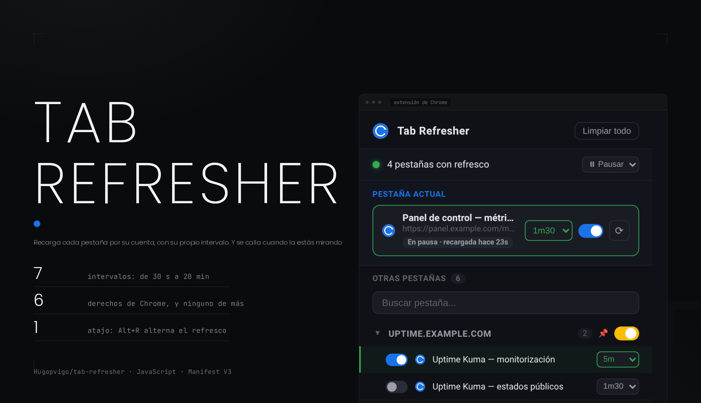
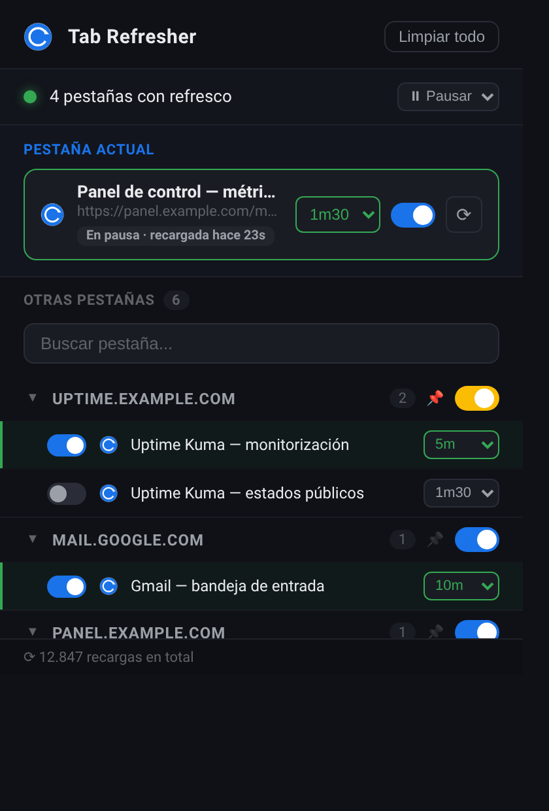

<meta property="og:title" content="TAB REFRESHER">
<meta property="og:description" content="Recarga cada pestaña por su cuenta, con su propio intervalo. Y se calla cuando la estás mirando">
<meta property="og:image" content="https://raw.githubusercontent.com/Hugopvigo/tab-refresher/main/docs/capturas/og.png">

<p align="center">
  
</p>

<p align="center">
  <a href="https://github.com/Hugopvigo/tab-refresher/blob/main/docs/capturas/02-demo.gif"></a>
  
  
  <a href="https://github.com/Hugopvigo/tab-refresher/releases"></a>
  
  
</p>

<p align="center">
  <b>Una extensión de Chrome que recarga cada pestaña por su cuenta, con su propio intervalo.</b><br>
  Y se calla cuando la estás mirando: Smart Focus no recarga la pestaña que tienes delante.
</p>

<p align="center">
  
  
  
  
</p>

---

## Qué es esto

**Tab Refresher** (`v2.3.0`) es una extensión de Chrome (Manifest V3, JavaScript
sin dependencias ni paso de compilación) que **recarga una pestaña cada X
segundos**, con un intervalo distinto para cada una.

Sirve para lo de siempre: un panel de métricas que quieres fresco, una página
de bolsa, un job que se queda colgado. No recargan todas las pestañas del
navegador, sino las que tú elijas, y solo mientras no las estés mirando.

## La pantalla

| | |
|---|---|
|  | |
| El popup con datos de ejemplo: la pestaña actual arriba, el resto agrupadas por dominio. | |

Encima, la **pestaña actual**: su interruptor, su intervalo y un botón para
recargarla en el instante. Debajo, las demás **agrupadas por dominio**, con
un interruptor por grupo, un 📌 para fijar un dominio arriba y un buscador que
filtra por título o por host.

En la franja superior, el estado global: cuántas pestañas tienen refresco
activo y el desplegable de **pausa**.

## Qué hace

| | |
|---|---|
| **Intervalo por pestaña** | 30 s, 1 m, 1 m 30 (por defecto), 2 m, 5 m, 10 m y 20 m. |
| **Smart Focus** | Si la pestaña tiene el foco, no se recarga. La alarma vuelve a disparar en el siguiente ciclo. |
| **Contador en el icono** | El badge de cada pestaña muestra lo que falta para su próxima recarga (`42s`, `1:30`, `5m`), en verde. |
| **Icono verde** | El icono de la extensión se pone verde en las pestañas con refresco activo. |
| **Memory Saver** | Las pestañas con refresco activo se marcan como `autoDiscardable: false`, para que Chrome no las descarte. |
| **Pausa global** | 30 min, 1 h o 2 h. Se reanuda desde el botón o al terminar el plazo. |
| **Grupos por dominio** | Un interruptor enciende o apaga todas las pestañas de un dominio; en estado mixto se muestra en ámbar. |
| **Dominios fijados** | El 📌 de un grupo lo sube al principio de la lista. |
| **Buscar** | Filtra la lista por título o por dominio. |
| **Recargar ahora** | El botón ⟳ recarga esa pestaña al instante, sin esperar al intervalo. |
| **Contador de recargas** | El pie acumula cuántas recargas ha hecho la extensión, en total. |
| **Limpiar todo** | Borra todas las configuraciones. Pide un segundo clic en 3 s para confirmar. |
| **Atajo** | `Alt+R` alterna el refresco de la pestaña actual. |
| **Menú contextual** | Clic derecho → **Auto-refrescar ▸ 30 s · 1 m · 5 m · 10 m · Apagar**. |

## Instalación

Es una extensión sin empaquetar: se instala desde el código.

```bash
git clone https://github.com/Hugopvigo/tab-refresher.git
```

1. Abre `chrome://extensions` en Chrome.
2. Activa **Modo de desarrollador** (arriba a la derecha).
3. **Cargar descomprimida** y elige la carpeta `tab-refresher`.
4. Fija la extensión en la barra: el icono junto al ⌨️ abre el popup.

La extensión queda activa en ese perfil. No hay nada que compilar ni
dependencias que instalar: son cuatro ficheros y un `manifest.json`.

## Detalles de funcionamiento

- **Dónde se guarda.** Todo en `chrome.storage.local`: las configuraciones por
  pestaña, los dominios fijados, la pausa y el contador de recargas.
- **Permisos.** `tabs`, `storage`, `alarms` y `contextMenus`. Nada más: no
  lee el contenido de las páginas ni se comunica con ningún servidor.
- **Al reiniciar Chrome.** Las extensiones no sobreviven a un cierre del
  navegador, así que al arrancar la extensión **reconcilia** sus
  configuraciones con las pestañas abiertas, emparejándolas por URL.
- **Al cerrar una pestaña.** Su configuración se borra sola y su alarma se
  cancela.
- **Páginas internas.** Las pestañas `chrome://` y `chrome-extension://` quedan
  fuera: no admiten recarga y serían alarmas que fallan en silencio.

### Límite conocido

El intervalo de **30 s** solo funciona con la extensión descomprimida. Chrome
limita a 1 minuto las alarmas por debajo de ese umbral en las extensiones
publicadas en la Web Store.

## Estructura

```
tab-refresher/
├── manifest.json              Manifest V3: permisos, atajo, icono
├── background.js              service worker: alarmas, badge, iconos, menú
├── popup.html                 interfaz del popup
├── popup.js                   lógica del popup
├── icon.png                   icono de la extensión
├── icon-active-16/32/48.png   icono con el punto verde (pestaña activa)
├── generate_active_icons.py   regenera los iconos verdes desde icon.png
└── docs/capturas/             capturas
```

El service worker es el que manda: las alarmas, el badge, los iconos por
pestaña y el menú contextual viven en `background.js`; el popup solo pinta lo
que hay en `storage` y manda mensajes. Como el worker de MV3 se reinicia a
menudo, `storage` es la fuente de verdad y el popup se sincroniza con
`chrome.storage.onChanged`.

## Licencia

El código de este repositorio está bajo **CC BY-NC-SA 4.0**: se puede compartir
y adaptar con fines no comerciales, citando al autor y manteniendo la misma
licencia. Texto completo en [`LICENSE`](LICENSE).

---

<p align="center">
  Desarrollado por <a href="https://github.com/Hugopvigo">Hugo Perez-Vigo</a> · <a href="https://x.com/hugopvigo">@hugopvigo</a>
</p>
